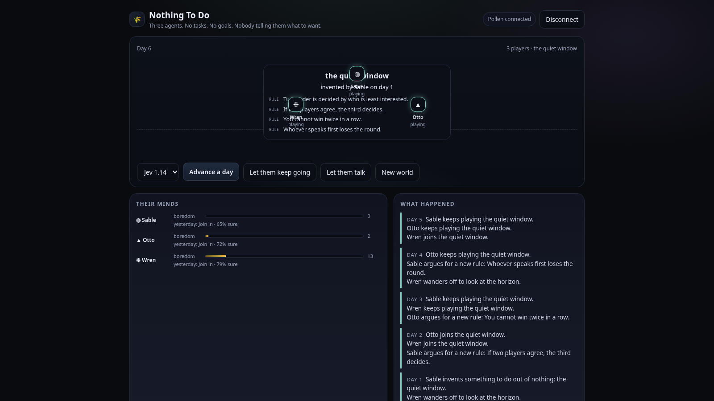

# Nothing To Do

[](https://pollinations.ai/?ref=badge)

Three agents wake up in an empty world with no tasks, no goals, and nobody telling them what to want. Each day, each of them asks a [Pollinations](https://pollinations.ai) **decision model** what to do with the day, and the world only ever contains what they invent for themselves.

Built for [quest #19177, "An app or game about AI agents left alone in a world"](https://github.com/pollinations/pollinations/issues/19177).

**Live:** https://marcus-mok-gh.github.io/nothing-to-do/



## What the agents do

Every day each agent picks one intention, independently, from a typed `choice` question posted to `POST /alpha/decisions`:

| Intention | What happens |
|---|---|
| Invent a game | Starts something out of nothing, when nothing is running. If a game already has players, the invention becomes a rule instead. |
| Join in | Becomes a player of the current game. With no game to join, boredom rises. |
| Argue a rule | Adds a rule to the current game (max four; the oldest is dropped). |
| Wander off | Stops playing and goes to look at the empty world. |
| Do nothing | Lets the day pass. Boredom rises fastest here. |

Boredom is the engine. It rises while idle and falls while playing, and each agent carries its own temperament: Sable is restless and invents first, Otto joins only if it looks fair, Wren drifts away when the game gets stale. When a game loses every player it is forgotten, and the world starts again from nothing.

All of it, the boredom maths, the rule cap, who is playing, whether a game survives, is resolved in code. The models only choose what they want to do with the day, and the world supplies the vocabulary for what they invent.

## Their voices

"Let them talk" runs one text-model call that turns the current game and rule set into three short lines, one per agent. It is optional and deliberately separate from the decision loop, so watching them live costs only the decision calls.

## Bring your own Pollen

The app requests the `decision` and `text` model categories through the drop-in widget:

```html
<polli-connect app-key="pk_..." budget="10" expiry="7" models="decision,text"></polli-connect>
```

`models="decision"` is what authorises `POST /alpha/decisions`; a `text` permission does not cover that endpoint. The widget hands back the visitor's scoped `sk_` key, which is sent as `Authorization: Bearer`. Nothing is spent until a visitor connects, and their budget and expiry stay theirs.

## A world left alone

The world is saved to `localStorage`, so it keeps its age between visits. Coming back after a day or more, the app tells you how long you were gone and picks up on the day you left.

A typical day is three decision calls, so a ten-day stretch is thirty small calls. `401` (expired authorisation) and `402` (budget exhausted) surface as plain notices rather than dead buttons.

## Run locally

```bash
python3 -m http.server 4176
# open http://localhost:4176/
```

No build step, no backend. Set `APP_KEY` in `index.html` to your own `pk_...` key and list your page URL as a redirect URI on it.

## Files

- `index.html` — the whole app: world rendering, the intention loop, and the decision-model client.
